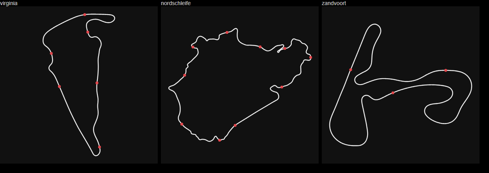

# Phase 0 Findings — Rig Discovery

> **Status:** Phase 0 gate met — questions 1 and 2 answered on real hardware, 2026-09-16.
> Companion to [`local-first-refactor-plan.md`](local-first-refactor-plan.md) §8.
> Probes are dependency-free Node scripts in [`phase0-probes`](phase0-probes) and re-run in seconds.

**Machine:** Windows 11 Home · iRacing via Steam · SimHub 9.12.6 · .NET SDK 8.0.301 · Node 24.14.
**Corpus:** 3,030 `.ibt` files, 97.4 GB, 2025-10-03 → 2026-09-16, 80 track layouts, 809 subsessions.

---

## Summary

| # | Question | Answer |
|---|---|---|
| 1 | Where is iRacing's track map data, is it machine-readable? | In signed, zstd-compressed `.dat` packs — undocumented, and we should not read them. **We don't need to:** the user's own `.ibt` files carry `Lat`/`Lon`/`Alt`, and an outline derived from them matches the YAML `TrackLength` to within 0.01–0.28%. |
| 2 | Installed-content layout | Deterministic. `TrackName` ↔ path under `tracks\`, `CarPath` ↔ path under `cars\`. With one user, installed = owned is good enough. |
| 3 | `.ibt` naming, retention, history depth | `<carPath>_<trackName> <yyyy-mm-dd hh-mm-ss>.ibt`, no rollover, full history since install — **on this rig, with `irsdkAutoLogDisk=1`**. |
| 4 | Do the S3 widgets expose anything to the SDK? | No. Zero variables added after 2026 S3. |
| 5 | Does the iRacing UI cache the schedule locally? | **No.** *(Corrected — an earlier keyword count mistook cached race results and the UI's own JS for schedule data.)* The schedule reaches the UI over JSON-RPC, which the HTTP cache never stores. iRacing publishes a public schedule PDF per season instead. |
| 6 | SimHub-optional viability; OAuth status | Viable — SimHub types touch 3 of 46 files. **But the core can't target netstandard2.0** (IRSDKSharper has no such build). OAuth client-ID creation still paused. |

### Where the plan was wrong

1. **`irsdkLogAllCars=1` does not put the field into `.ibt`.** No `CarIdx*` array appears in *any* of the
   3,029 readable files. The setting's own description is *"Log all cars to setup, or just the original
   64 for backwards compatibility"* — it's about the >64-car limit, not disk logging. §1 bet #3 and the
   S2/relative-pace claims in §2 need rewording. Grid iRatings and end-of-session results still come
   from the YAML (below), so S2 survives; frame-level opponent pace from history does not.
2. **The core can't be `netstandard2.0`.** IRSDKSharper 1.1.4 ships `net471`, `net6.0-windows7.0`,
   `net7.0-windows7.0` only. Multi-target the core as `net48;net8.0-windows` instead — same outcome
   (one codebase, both hosts), no dependency swap.
3. **Track geometry source order flips.** The plan preferred the sim's on-disk map data, with runtime
   recording as fallback. Actual order: **`.ibt` Lat/Lon → live dead reckoning.** The sim's `.dat` is
   out.
4. **Cold-start backfill depends on a non-default-looking setting** *(moot under single-user scope)*. Months of `.ibt` exist here because
   `irsdkAutoLogDisk=1`. Whether that's iRacing's default on a fresh install is **unverified**; if not,
   a typical new user has little or nothing to backfill.
5. **Don't locate iRacing via the uninstall registry key.** On this rig it points at
   `D:\SteamLibrary\...\iRacing`, a stale partial copy (3 tracks, 2 cars, no sim exe). The real install
   is on `C:`.

### Scope: one user

**Decided 2026-09-16: design for a single user — Kevin, on this rig.** No onboarding for strangers, no
generic priors, no ownership inference beyond "it's installed". Cold start is a non-issue: 11 months of
history already exist.

### Decisions

| Decision | Status |
|---|---|
| Decode the sim's track `.dat` packs? | **No (decided 2026-09-16).** Rationale in *What decoding `.dat` would buy* below. |
| Read schedule data from the iRacing UI's HTTP cache? | **Moot** — Kevin said yes, but the cache has no schedule (§5). **Replacement decided 2026-09-16: iRacing's official season schedule PDF**, not the week-planner scrape. |
| Turn on `irsdkAutoLogDisk` if it's off? | **Yes (decided).** Check `app.ini` at launch; if disk logging is off, offer to turn it on. It's already on here, so in practice this is a guard against it being switched off. |

### What decoding `.dat` would buy

| Gain | Size of it | Cheaper route |
|---|---|---|
| Maps for layouts never driven | 425 installed layouts, 71 driven under current names → **354 without `.ibt` geometry** | One out-lap in a test session produces the `.ibt`; the live dead-reckoned map covers the first lap |
| Track edges, width, pit lane, maybe turn positions — richer rendering than a driven line | **Unknown.** Contents are unverified. Layout files have a 605 KB median — small enough to suggest layout metadata rather than meshes, but that's a guess | None from `.ibt`: lap-to-lap spread is ~1 m, so driven laps don't reveal track width. Render from the driven line, as the plan already assumes |
| S6 archetypes (curvature, elevation) for tracks never raced | Same 354 layouts | Public real-world geometry (e.g. OpenStreetMap `highway=raceway`) for real circuits — not iRacing's data |

Costs: an undocumented, signed, compressed format that can change with any iRacing update; days to
weeks of reverse-engineering with no guarantee the contents are what we want; and whatever iRacing's
terms say about reverse engineering (not checked) lands on *your* account — one user doesn't change that.

---

## 1. Track geometry

### The sim's own map data — not usable

Every layout is a directory with a packed `.dat` (`tracks\zandvoort\2023\gp\gp.dat`, 937 KB) under a
base pack (`tracks\zandvoort\2023\2023.dat`, 1.7 GB). Headers are `03 00` + ~80 bytes of what looks like
a hash/signature, a small chunk table, then zstd frames (`28 B5 2F FD` at offset `0x62`). Probing
stopped at the header — see *Decisions needed*.

### The user's own `.ibt` — the answer

Disk telemetry records `Lat` / `Lon` (double, degrees) and `Alt` (float, m) every frame at 60 Hz,
alongside `LapDistPct`. Present in 3,028 of 3,029 readable files. These are **disk-only** variables —
live shared memory doesn't have them, which is why `TrackMapProvider.cs` dead-reckons from
`VelocityX/Z` + heading.

Method (`ibt-geometry.mjs`): keep laps that are fully `PlayerTrackSurface == OnTrack`, never on pit
road, and cover `LapDistPct` 0→1 monotonically; project to local metres; resample each lap into
`LapDistPct` bins of ~5 m (minimum 1,000); average across laps.

| Layout | Bins | Clean laps | Derived length | YAML `TrackLength` | Error | Lateral spread (median / p95) | Elevation range | Time |
|---|---:|---:|---:|---:|---:|---|---:|---:|
| Virginia — Full Course | 1,043 | 14 | 5,217 m | 5,216.9 m | **+0.01%** | 0.91 / 2.19 m | 38 m | 90 ms |
| Circuit Zandvoort — GP | 1,000 | 1 | 4,211 m | 4,206.8 m | **+0.10%** | — | 8.9 m | 351 ms |
| Nordschleife — Industriefahrten | 4,128 | 2 | 20,580 m | 20,638.3 m | **−0.28%** | 0.25 / 1.08 m | 293 m | 112 ms |

At a fixed 1,000 bins the Nordschleife came out at −0.35%; finer bins only recover part of that, so
the remaining ~58 m isn't resolution. Unexplained — possibly the driven line against a centreline
measurement over a very twisty 20 km. It's invisible at
HUD scale, and positions are placed by `LapDistPct`, so it doesn't accumulate. All three outlines close
to within ~1 bin spacing and render correctly in the existing 0–100 viewBox / 5% padding convention:



**Why this beats both alternatives:** GPS-grade positions rather than drift-prone dead reckoning; no
first-lap gap for any layout the user has driven before; free elevation, which S6 (track archetypes)
wants anyway; a documented format; and it's the user's own data.

**Implementation notes for Phase 2:**

- **Key geometry by `TrackID`, not name.** Road America and Mid-Ohio were re-released as `2026`
  layouts; older files reference `roadamerica full` / `midohio full`, which no longer exist on disk.
- **One good file per layout is enough.** Geometry backfill for all 80 layouts is roughly 80 × <1 s,
  not a 97 GB read. Prefer the file with the most clean laps; refine as new sessions arrive.
- **The clean-lap filter is too strict for some sessions** — a 37-lap Zandvoort file yielded 1 clean lap.
  Tolerate brief surface flickers rather than rejecting the lap.
- **Sectors:** `SplitTimeInfo.Sectors[].SectorStartPct` maps straight onto the bins (red dots above).
  Present in 3,027 files.
- **Don't assume every layout closes.** All three tested did (within ~1 bin), but a true
  point-to-point layout (hillclimbs) wouldn't — check the start/finish gap before emitting `Z`.

### `lapfiles\` — noted, not needed

`Documents\iRacing\lapfiles\<trackName>\<custId>_<carPath>.{blap,olap,blapta,olapta}` — 678 files
across 79 layouts. Uncompressed binary with a `BLAP` magic, version 3, customer ID, display name and
car path in the header; fixed size per layout (60,480 B at Zandvoort, 61,700 B at Oulton). Probably the
best/optimal-lap traces behind the delta bar. Undocumented, and `.ibt` already covers the need, so it
wasn't decoded.

---

## 2. Installed content

**Locate the install through Steam, not the uninstall key.** `Steam\steamapps\libraryfolders.vdf`
lists app `266410` under the library that actually holds it; `appmanifest_266410.acf` in that library
gives `installdir`. Validate by the presence of `iRacingSim64DX11.exe`. Non-Steam installs still need a
separate check (`Program Files (x86)\iRacing` — absent here).

**Layout** (`C:\Program Files (x86)\Steam\steamapps\common\iRacing`, 209 GB):

| SDK field | Path rule | Check |
|---|---|---|
| `WeekendInfo.TrackName` `zandvoort 2023 gp` | split on spaces → `tracks\zandvoort\2023\gp\gp.dat` | 77 / 79 driven layouts resolve; the 2 misses are superseded layouts (above) |
| `DriverInfo…CarPath` `mx5 mx52016` | split on spaces → `cars\mx5\mx52016\` | 53 / 53 driven cars resolve |

141 track directories, 128 car directories; each has a `version.txt` (e.g. `2026.08.31.03`) that the
updater log confirms is the package version.

**S1:** a directory on disk shows content was *downloaded*, not strictly *owned*. Under single-user scope
that's accepted as-is.

---

## 3. `.ibt` history

| | |
|---|---|
| Location | `Documents\iRacing\telemetry\` |
| Naming | `<carPath>_<trackName> <yyyy-mm-dd hh-mm-ss>.ibt` (spaces inside both names) |
| Retention | None observed — every month since install present (136–392 files/month) |
| Size | 97.4 GB total, 19.9 MB median; 256 files > 100 MB (`irsdkLimitFileSize=0` here) |
| Sessions | 1,242 Race · 832 Practice · 776 Test · 177 Time Attack · 1 Qualify; 2,037 official |
| Grid data | 1,204 race files have multiple non-zero iRatings in `DriverInfo`; median grid 23 |
| Results | 1,019 race files carry `ResultsPositions` |
| Damage | 1 unreadable (truncated header), 14 with zero laps — ingest must skip, not fail |
| Header scan | All 3,030 files (header + var table + YAML, no frames) in **4.8 s** |

Relevant `app.ini [Telemetry]` on this rig: `irsdkEnableDisk=1`, `irsdkAutoLogDisk=1`,
`irsdkLogAllCars=1`, `irsdkLog360Hz=0`, `irsdkLimitFileSize=0`, `irsdkLogSetup=1`.

### The research upload (re-checked 2026-09-18)

Not a threat to history: the sim writes a second, smaller
disk-telemetry file per session — its "internalHelper", beside the normal logger — into
`%LOCALAPPDATA%\iRacing\internal\` as `ibtv1_<trackId>_<carId>_Members_<hash> <date>.ibt` (the format string
is in `iRacingSim64DX11.exe`; no `app.ini` key governs it). The iRacing UI's "MSR telemetry" routine MD5s each
one, uploads it with a presigned URL to `research-driver-training-data.s3.amazonaws.com/ibtv1/<date>/<trackId>/<carId>/Members/`,
records it in `internal\telemetry_status.json`, then deletes it. iRacing calls this its anonymised race-data
collection "to power future improvements and features", on in select official series, with an opt-out under
**Settings > Preferences** in the iRacing UI
([2025 S1 telemetry update](https://support.iracing.com/support/solutions/articles/31000175681)). On this rig
the ledger holds 778 uploads since 2025-08-26 (5.3 GB), all `completed`; the 765 matched to `telemetry\` are all
official-series sessions (436 races, 328 practices, 1 qualify) — no Test, Time Attack or unofficial session, and
only some official series. Each is 23–26% of the matching `telemetry\` file, near-constant
per car, which fits a fixed subset of channels at the same rate rather than a copy — but none survive
locally, so which channels is unverified; copy one out of `internal\` during a session to see. Nothing in
`telemetry\` is touched.

---

## 4. SDK exposure of the S3 widgets

Union of variable names across all files before 2026-06-09 (356) vs. after (337): **zero variables
exist only after S3.** The Fuel Calculator and Incident Tracker widgets expose nothing new. Differences
the other way are car-specific `dc*`/`dp*` controls for cars not driven since. Fuel and incident inputs
remain what they were: `FuelLevel`, `FuelLevelPct`, `FuelUsePerHour`, `PlayerCarMyIncidentCount`,
`PlayerIncidents` (`irsdk_IncidentFlags`), etc.

**No `CarIdx*` arrays in disk telemetry, ever** (see correction 1). If the product wants frame-level
opponent history, the core has to record `CarIdx*` from shared memory live into SQLite — that's a
Phase 2 schema decision, not a backfill.

---

## 5. Local schedule cache

**No schedule is cached.** `%APPDATA%\iracing-electron\` is the iRacing UI's Electron profile. A
first pass counted keyword hits and wrongly read them as schedule data. Parsing the Chromium blockfile
cache properly (`phase0-probes/chromium-cache.mjs` — URL keys and bodies only, never the header stream)
shows what's actually in the 17,916 entries:

| Source | Entries | What it is |
|---|---:|---|
| `127.0.0.1:32034/get_dload_status2`, `pk_*.png` | 16,631 | The local iRacing service: content download status, paint previews |
| `members-assets.iracing.com/public/…` | 573 | Guided-tour JSON, loading-screen video |
| `scorpio-assets…/short_lived/series_search/<hash>` | 7 | **Your recent race results** (per-race rows: SoF, finish, incidents) — the source of the `race_week_num` hits |
| `scorpio-assets…/weather-forecast/season/<id>/rw<n>_evt<n>_display.json` | 22 | Public weather forecasts for 11 seasons — weather only, no track or series mapping |
| `season_schedule` hits | — | V8 code cache of the UI's own JavaScript, not data |

The UI fetches schedules over JSON-RPC (its log shows `JsonRpcError`), which never touches the HTTP
cache. **Replacement:** iRacing publishes a preliminary schedule PDF per season (200+ pages: tracks,
race lengths, frequency, incident limits) on its
[season page](https://www.iracing.com/seasons/2026-s4/). Quarterly, public, no auth.

---

## 6. SimHub-optional; OAuth

**SimHub coupling is small.** SimHub/GameReader types appear in 3 of 46 `.cs` files in
`RaceCorProDrive.Plugin`: `Plugin.cs` (2,098 lines), `Engine/TelemetrySnapshot.Capture.cs` (1,052),
`Transport/TelemetryFrame.cs` (566). The only other net48-only API use is `System.Drawing` /
`System.Windows.Forms` in `Engine/ScreenColorSampler.cs`. `Fleck`, `MessagePack`, `Newtonsoft.Json`
and `log4net` all have modern targets.

**Blocker for netstandard2.0:** `IRSDKSharper` 1.1.4 (`lib/net471`, `lib/net6.0-windows7.0`,
`lib/net7.0-windows7.0`). Multi-target `net48;net8.0-windows`.

**OAuth:** re-checked 2026-09-16 — *"We have paused the creation of OAuth client IDs while we evaluate
existing 3rd party usage of iRacing's APIs and SDK."* No reopening date. The plan needs none of it.

---

## Reproduce

```bash
node docs/phase0-probes/ibt-inspect.mjs "<path>.ibt"      # header, vars, YAML fields
node docs/phase0-probes/ibt-scan.mjs "<Documents>/iRacing/telemetry"   # corpus summary
node docs/phase0-probes/ibt-vardiff.mjs "<Documents>/iRacing/telemetry" # vars before/after S3
node docs/phase0-probes/ibt-geometry.mjs "<path>.ibt" out.svg           # outline + validation
# chromium-cache.mjs exports openCache / decodeBody / urlOf — URL keys and bodies, never the header stream
```

`ibt-scan.mjs` writes `ibt-scan.json` next to itself; it contains subsession IDs, so it's gitignored.
